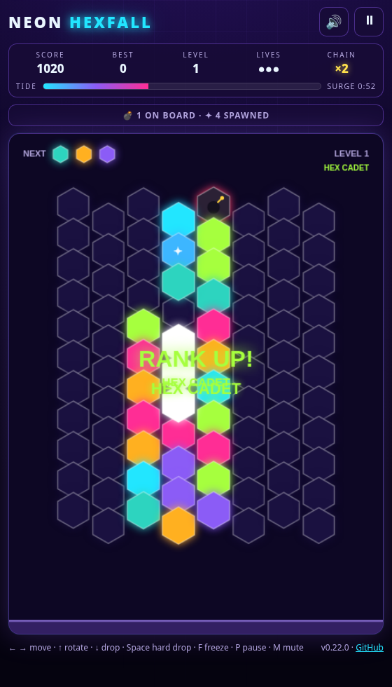
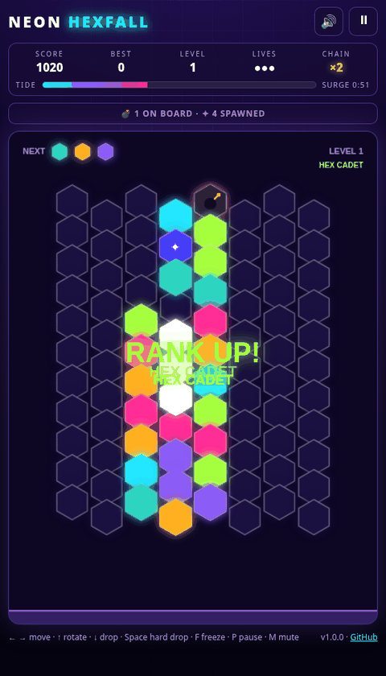
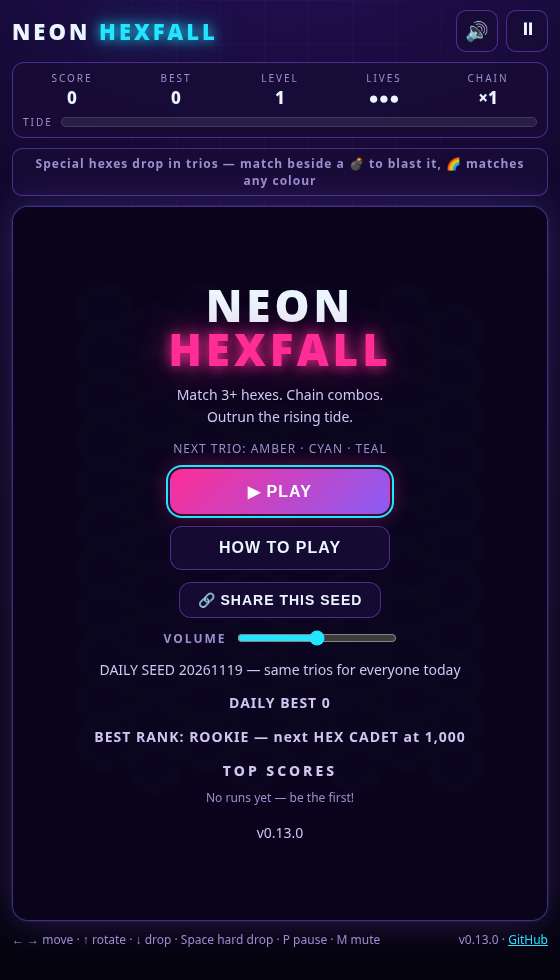

# Neon Hexfall

A fast falling-hex arcade puzzle. Hex trios fall from the top — match **3 or more connected hexes** of the same colour to clear them, chain cascades for big multipliers, and outrun the rising tide.

**Play it live:** https://namdev-muse.github.io/neon-hexfall/

## Screenshots

Gameplay, captured from the real game in a headless browser (see
`tests/screenshot.js` to regenerate them):

Main menu:

## How to play

- **← →** move the falling trio · **↑** rotate its colours · **↓** soft drop · **Space** hard drop · **F** spend a held tide freeze
- **P** pause · **M** mute · touch buttons on mobile, or swipe the board to move, drag down to soft-drop, flick down to hard-drop, tap the left / middle / right of the board to move / rotate
- Menus are fully keyboard-playable: **↑ ↓** move between buttons, **Enter** activates, **Esc** steps back
- Match 3+ connected hexes of one colour to clear them. Clears that cascade after hexes fall count as chains (×2, ×3, …) and multiply your score.
- The **tide** rises as you play. When it fills, a row of grey **slag** surges up from the bottom. Slag never matches — clear it by matching hexes next to it.
- If the stack reaches the top you lose a life and the tide breaks the top rows away. Lose all 3 lives and the run ends.
- Every 6 clears you level up: trios fall faster, the tide rises faster, and you pick **1 of 3 upgrades** — a slower tide, an extra life, or wider matches that let pairs of 2 hexes clear (1, 2 or 3 to pick, or arrows + Enter).
- **Modes:** **CLASSIC** is the 3-lives run with the rising tide. **⚡ BLITZ 60s** gives you one minute to score as much as you can — the clock replaces the lives counter and ticks in the last 10 seconds. **ENDLESS** has no lives: a single top-out ends the run. **ZEN** has no tide and no lives lost, so you can play as long as you like. Each mode keeps its own best score, and the top-5 table records which mode a score was set in.
- Everyone plays the same trio sequence each day (daily seed, shown on the menu).
- Daily challenge: each seed has its own daily best, shown on the menu and the game-over screen.
- Rank titles: climb from Rookie to Hex Legend as your score grows; rank-ups flash in-game.
- Shareable seeds: copy a link from the menu or the game-over screen and anyone opening it plays the exact same trio sequence.
- Local top-5 high-score table on the menu and the game-over screen (new entries highlighted, with a ★ TOP 5 ★ badge).
- Game-over stats screen: score, best, daily best, rank, level, time, hexes cleared, matches, best chain, biggest match, all clears, bombs, rainbows, freezes collected / used, lifetime runs / hexes / best chain, and accuracy (hexes cleared per trio).
- Powerup HUD indicators: live bomb / rainbow counts on the board, specials in the next trio, and countdowns for active timed effects.

## Features

- Falling tri-hex pieces with rotate / soft drop / hard drop and a ghost landing preview
- Match-3+ flood-fill clears with gravity cascades and chain multipliers
- Chain combo display: big CHAIN ×N banner, per-cascade score popups at the cleared group, gold chain value in the HUD
- Match-size bonuses: 4-hex matches pay +200, 5 pay +400, 6+ pay +800 (× chain); ALL CLEAR bonus (+1000 × level) for emptying the board
- Powerups: bomb hexes detonate when a match clears next to them (50 pts per blasted hex, chain-detonating nearby bombs); rainbow hexes match any colour; slow-tide hexes freeze the tide for 15s; tide-break hexes clear the bottom two rows; freeze hexes are banked (hold up to 3) and spent with **F** to freeze the tide for 10s exactly when you need it; specials drop inside trios (chance grows with level, guaranteed at least every 12 trios)
- Rising tide pressure mechanic with slag surge rows
- Extra modes: Blitz 60s (score attack on a countdown clock), Endless (no lives — one top-out ends the run), Zen (no tide, no lives lost); per-mode bests, mode shown on the game-over stats and in the top-5 table
- 3 lives with tide-break recovery on top-out
- Levels with speed + tide ramp (gentler at level 1, harder late game), best score in localStorage, lifetime run totals on the menu
- Level-up upgrade draft: every level-up pauses the run on a pick-1-of-3 draft — slower tide (×1.25 per pick), +1 life (max 5), or wider matches (pairs of 2 clear at 50 pts each, +10 per pick, max 70); banked freeze, bottom-rows break or +500 points fill in when an upgrade is maxed out or doesn't fit the mode. Picks show in the HUD strip and the game-over stats, and survive a refresh via the autosave.
- Neon Canvas 2D visuals: glowing hexes, particles, floating score text, screen shake, tide waterline
- Web Audio synth SFX + bass music loop, mute persisted
- Keyboard, mouse/touch buttons, and swipe/tap controls; pause / game-over screens; screen-reader announcements
- Small-phone responsive layout: safe-area insets, compact short-screen rhythm, thumb-sized touch targets, no pull-to-refresh while swiping the board
- Installable PWA: add it to your home screen from the browser menu and it runs fullscreen standalone; after one visit it works offline, thanks to a versioned service worker cache (`sw.js`, registered by the game on http/https only). Icons + the 1200×630 social preview are generated from the hex logo with `python3 tests/make-icons.py`; link previews use Open Graph / Twitter large-card meta.

## Tech

Vanilla HTML/CSS/JS, Canvas 2D, Web Audio API. No build step, no dependencies. Deployed to GitHub Pages from `main` via GitHub Actions (`.github/workflows/ci-pages.yml` validates syntax and runs the smoke test on every push).

## Testing

- `node tests/smoke.js` — stub-DOM harness (735 checks): boot, movement, rotation, hard drop, match clears, chain cascades, tide surge, slag crumbling, top-out / lives / game over, pause, mute, level-up, daily challenge / ranks / shareable seed, top-5 table, game-over stats, powerup HUD indicators, tide-freeze pickup + spending, difficulty curve values, lifetime run stats, touch tap / swipe / flick, keyboard-only menu navigation, responsive CSS checks, PWA manifest / icons / social preview / service worker registration, level-up upgrade draft (offers per mode, tide / life / wide effects, keyboard picking, save/restore mid-draft), CONTINUE-button visibility, v1.0 release artifacts (changelog, release notes, README), and a 2000-step random-input soak with board-consistency checks.
- `node tests/bot.js` — auto-play bot harness (15 checks): 10 full greedy-bot games with a board audit after every lock, plus a determinism replay (same seed, same score).
- `node tests/cross-browser.js` — headless Chromium 159 + Firefox 159 over local HTTP (11 checks each): menu version, first-visit how-to, live play, save/restore across a reload, zero console/page errors.
- `node --check game.js` — syntax check (also run by CI).
- `node tests/screenshot.js` + `python3 tests/gif.py` — regenerates the real gameplay screenshots and GIF in `docs/` from a headless browser run (needs `playwright-core` + a headless Chromium; see the script header).

## Development

This is game #2 in a rolling 12-hour sprint cadence (one complete game every 12 hours). Sprint log: `docs/devlog.md`.

## License

MIT — see [LICENSE](LICENSE).
